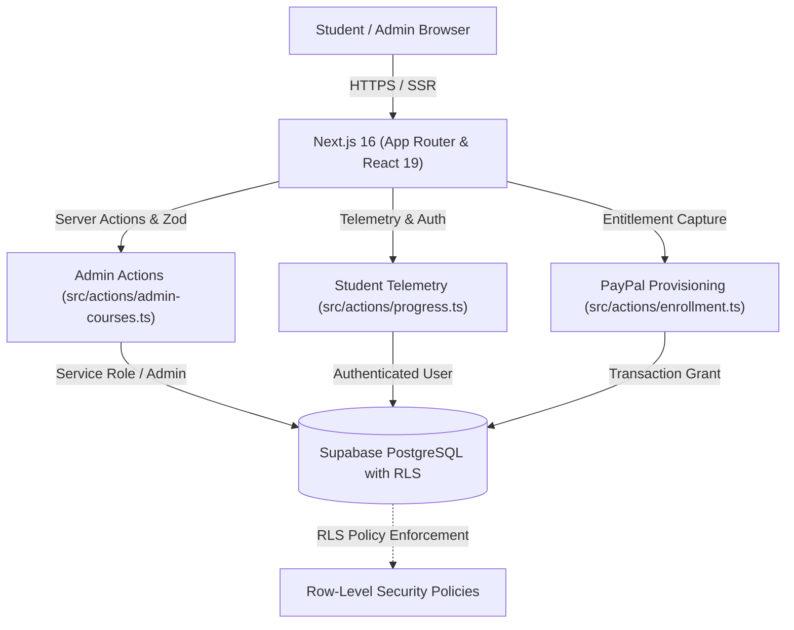

# System Architecture — AKStack Multi-Course LMS

## 1. High-Level Architecture Diagram

## 2. Security Boundaries & Entitlement Gating
1. **Database Layer (RLS):**
   - Tables: `courses`, `modules`, `lessons`, `course_enrollments`, `lesson_progress`.
   - Security-definer functions: `public.is_admin()`, `public.has_course_access(p_course_id)`.
   - Preview lessons are open; protected lessons are accessible ONLY to users with active enrollment records or admin claims.
2. **Application Layer (Server Components):**
   - Server-side redirect in `/courses/[courseSlug]/[lessonSlug]/page.tsx` checks entitlement and redirects unauthorized students to the sales overview (`?locked=true`).
   - Admin routes (`/dashboard/admin/*`) enforce admin role checks.

## 3. Data Ingestion Pipeline
- `scripts/migrate-curriculum.ts` reads legacy `lessons.json`, organizes 90 daily lessons into 9 thematic modules (10 days each), and batch upserts into Supabase with unique slug indices.
