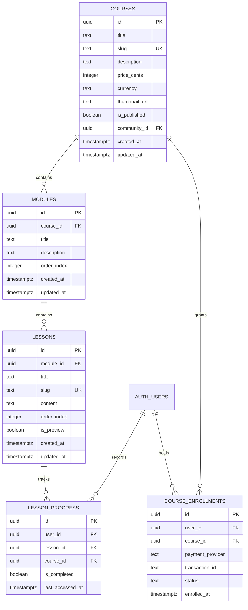

# Data Model & RLS Matrix — AKStack Multi-Course LMS

## 1. Entity-Relationship Model (Mermaid)

## 2. Row-Level Security (RLS) Policy Matrix
| Table | Operation | Target | Condition / Policy |
|---|---|---|---|
| `courses` | SELECT | Public | `is_published = true OR is_admin()` |
| `courses` | ALL | Admin | `is_admin()` |
| `modules` | SELECT | Public | Course is published OR `is_admin()` |
| `modules` | ALL | Admin | `is_admin()` |
| `lessons` | SELECT | Public | `is_preview = true` (in published courses) |
| `lessons` | SELECT | Student | `has_course_access(module.course_id)` |
| `lessons` | ALL | Admin | `is_admin()` |
| `course_enrollments` | SELECT | Student | `auth.uid() = user_id OR is_admin()` |
| `course_enrollments` | ALL | Admin | `is_admin()` |
| `lesson_progress` | ALL | Student | `auth.uid() = user_id OR is_admin()` |
